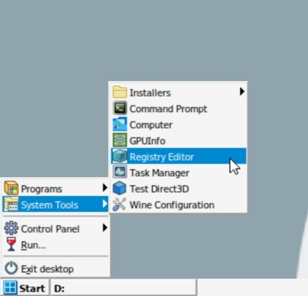
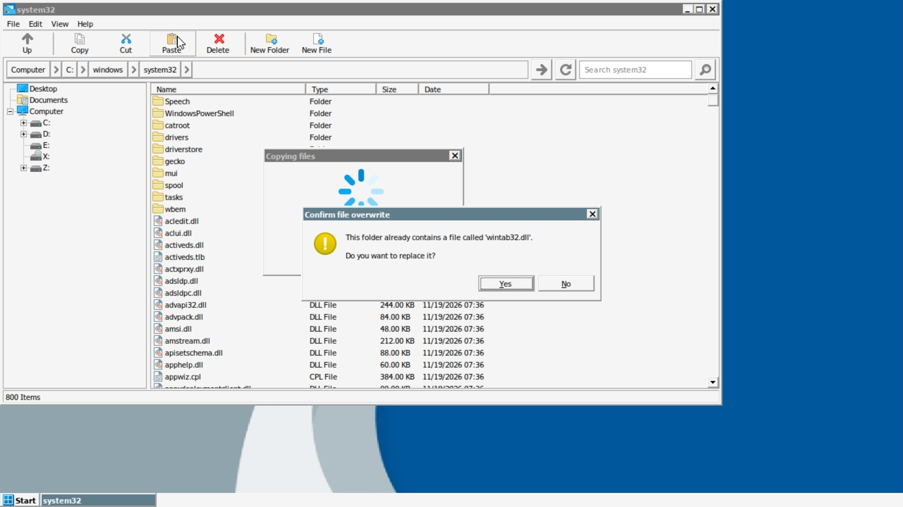

# PaintTool SAI Ver.2 安卓安装教程（新手向 · 图文）

> **做完能得到什么**：Windows 版 PaintTool SAI Ver.2 跑在 Android 平板上，
> 外接数位板或平板自带的笔有**真压感**（线条粗细随力度变化），笔能点菜单和工具栏。
>
> **不需要** root，**不需要**敲命令，全程在平板上点。
>
> **适用设备**：Android 10 以上、arm64，支持 OTG / 蓝牙数位板，或平板自带压感笔（如三星 S Pen）。
>
> **预计耗时**：30～60 分钟，其中容器初始化和 SAI 首次启动最慢。

---

## 目录

1. [开始之前](#一开始之前)
2. [准备文件](#二准备文件)
3. [第 1 步：装补丁版 Winlator](#第-1-步装补丁版-winlator)
4. [第 2 步：建容器](#第-2-步建容器)
5. [第 3 步：装中文字体](#第-3-步装中文字体)
6. [第 4 步：装压感桥](#第-4-步装压感桥)
7. [第 5 步：装入 SAI](#第-5-步装入-sai)
8. [第 6 步：验收](#第-6-步验收)
9. [日常怎么用](#日常怎么用)
10. [常见问题](#常见问题)
11. [附录：原理与文件位置](#附录原理与文件位置)

> **顺序很重要**：先把压感桥（第 4 步）装进容器，再装 SAI（第 5 步）。
> 反过来做也能成，但 SAI 第一次启动时如果没有桥，你会以为压感坏了，白白排查一轮。

---

## 一、开始之前

### 1.1 三句实话

- **这一版还不稳定，仅供尝鲜。** 请随时保存（`Ctrl+S`），别把正在画的稿子只留在内存里。
- **SAI 要你自己买、自己下。** 官方地址：<https://www.systemax.jp/>。本项目不提供 SAI 本体、安装包或授权。
- **不买授权也能画**，但**保存文件**需要 SYSTEMAX 的授权证书（`.slc`）。想先试手感的话，画完截图也行。

> 社区里流传的汉化版 / 整合包不是本项目提供的，来源和授权都没法核实，
> 用不用由你自己判断，出问题也别指望这里能修。

### 1.2 已经装了官方 Winlator 怎么办

**必须先卸载官方版**——补丁版包名相同但签名不同，装不上去。

> ⚠️ 卸载会**清空所有容器**，里面的 SAI、画稿、配置一起没。
> 如果里面有东西，先用文件管理器把 `Android/data/com.winlator/files/rootfs/home/` 整个复制出来备份。
> 全新安装没有这个问题。

---

## 二、准备文件

把下面这些文件全部放进平板的 **Download** 文件夹里的**同一个文件夹**中。
本教程把它命名成 `aaa教程用`，你在文件管理器里看到的会是 `aaa□□□□□□`——**这是正常的**，
因为现在容器里还没有中文字体，`教程用` 三个字显示不出来。认准开头是 `aaa` 的那个文件夹就行。

| 文件 | 用途 | 从哪来 |
|---|---|---|
| `Winlator-11.2-SAIPen.apk` | 补丁版 Winlator（内置压感发送端 + 笔点击支持） | Release 附件 |
| `wintab32.dll` | 压感桥，让 SAI 拿到笔压 | Release 附件 / 仓库 `dist/` |
| `wt_pmax.txt` | 压力上限（内容一行 `4095`） | 同上 |
| `1-压感覆盖.reg` | 让 Wine 优先加载我们的 `wintab32.dll` | 同上 |
| `2-中文字体.reg` | 让 Wine 用中文字体替换 Tahoma 等 | 同上 |
| `NotoSansCJK-Regular.ttc` | 中文字体，解决方块字 | **已随包提供**；缺失时见第 3 步自行下载 |
| PaintTool SAI Ver.2 64bit ZIP | SAI 本体 | **自己购买下载**，见 1.1 |

**平板的 Download 文件夹在容器里就是 `D:\`**，后面所有"从 D 盘复制"都指这里。

---

## 第 1 步：装补丁版 Winlator

1. 平板上允许「安装未知来源应用」。
2. 点开 `Winlator-11.2-SAIPen.apk` 安装。
3. 首次启动如果弹出 **16 KB 对齐 / 调试签名** 的警告，点「确定 / 继续」，不影响使用。

> **这个 APK 改了什么**：基于原版 Winlator 11.2 逐字节复制，只替换了 `classes.dex`、新增 `classes2.dex`。
> 资源、原生库、assets 全是原版字节，所以不会出现自建 APK 常见的"卡在 Starting up"。
> 它只多做两件事：① 把笔压通过 UDP 发给容器里的 `wintab32.dll`；② 把"笔尖接触"翻译成鼠标左键，让笔能点菜单。

---

## 第 2 步：建容器

### 2.1 新建容器

1. 打开 Winlator → 右上角 **＋** → 新建容器。
2. 名字随便填（例如 `SAI`）。
3. **屏幕分辨率（Screen Size）选 `custom`**，然后在右边填**设备本身的分辨率**。
   不知道的话：截一张图，在相册里看图片详情里的尺寸。
4. **DPI 适当调大**。参考值：11 英寸 2560×1600 的平板，填 `168` 左右比较舒服。
5. 其他保持默认，保存。

### 2.2 一个必须改的设置

| 位置 | 设置 | 为什么 |
|---|---|---|
| 左上角三横 → ⋮ → **Settings（设置）** | **取消勾选 `Capture pointer on external mouse`**（捕获外部鼠标指针），然后点右下角 ✓ 确认 | 勾着的话容器会抢走系统光标，**数位板事件根本进不来**，笔就完全没反应 |

### 2.3 第一次进容器

点容器右侧 **▶** 启动。首次会自动初始化 Wine，**可能要 1～5 分钟**，屏幕可能黑一会儿，
看到 Windows 桌面或文件管理器窗口就成功了。

> 退出容器请用返回键或右上角 ✕，**不要直接划掉 App 或强杀**。
> Wine 要把配置写回磁盘，被强杀可能丢设置——后面导入注册表时这一点尤其致命。

---

## 第 3 步：装中文字体

> 这一步很多人会跳过，结果装 SAI 时满屏 `□□□`，连安装按钮都认不出来。
> **先装字体，后面全程中文可读。**

### 3.1 字体文件

**字体已经在你下载的包里了**，不用另外找：

```
Download/aaa教程用（网盘内有相同内容）/NotoSansCJK-Regular.ttc      约 30 MB
Download/aaa教程用（网盘内有相同内容）/NotoSansCJK-LICENSE-OFL.txt  它的许可
```

用的是 **Noto Sans CJK**，开源（SIL OFL 1.1），可以自由分发。包里没有它的话，
从这几个地方拿，文件名要一致：

- 仓库：<https://github.com/notofonts/noto-cjk>
- 直链（Sans → OTC 合集）：<https://github.com/notofonts/noto-cjk/tree/main/Sans/OTC>

> 想用别的中文字体也行，但**字体族名要和 `2-中文字体.reg` 里写的一致**，
> 见 3.3 末尾的说明。用 Noto 最省事，和默认配置完全对得上。

### 3.2 把字体文件复制进 Fonts

1. 进容器，打开文件管理器（桌面上那个窗口）。
2. 左侧点 `D:\`（= 平板的 Download 文件夹）→ 进入 `aaa□□□□□□` 文件夹 → 选中 `NotoSansCJK-Regular.ttc` → 点工具栏的**复制（Copy）**。
3. 左侧点 `C:\` → 中间窗口双击 `windows` → 双击 `Fonts` → 点**粘贴（Paste）**。

### 3.3 导入字体替换表

只把字体拷进去还不够——SAI 里写死的是 `Tahoma`、`MS Shell Dlg` 这些 Windows 字体名，
必须告诉 Wine "用你的中文字体代替它们"。

**① 打开注册表编辑器**：左下角 **Start** → **System Tools** → **Registry Editor**。



**② 打开导入对话框**：菜单栏 **Registry → Import Registry File…**


**③ 选择文件**：在弹出的窗口里把 **Look in** 切换成 **My Computer**，
然后进 `(D:)` → `aaa□□□□□□` → 选 `2-□□□□.reg`（就是 `2-中文字体.reg`，文件名里的中文同样显示不出来）→ **Open / 确定**。


**④ 重启容器**：等几秒 → 返回点 **Exit** 正常退出容器 → 再从 Winlator 点 **▶** 进来。

现在中文应该能正常显示了。

> **换成别的字体？** 打开 `2-中文字体.reg` 看一眼，里面每一行都是
> `"Tahoma"="Noto Sans CJK SC"` 这种「Windows 字体名 = 你的字体族名」。
> 换字体就要把等号右边全改成那个字体的族名，写错一样是方块。
> 族名可以在字体的属性里看到；不确定就用 Noto，和默认配置一致。

---

## 第 4 步：装压感桥

> ⚠️ **这一步是"每个容器都要做一次"的。**
> `wintab32.dll`、`wt_pmax.txt`、注册表覆盖都存放在**容器内部**，不跟着 App 走。
> 只要**新建了容器**或**换到另一个容器**，就必须重做；否则 SAI 会弹「**WinTab 驱动返回了错误**」，
> 因为 Wine 加载的是它自带的空实现。

这一步就是压感的全部秘密：Android 收到的压力 → `wintab32.dll` → SAI。
**先把它装好，再去装 SAI**，这样 SAI 一启动就是能压感的状态。

### 4.1 把 `wintab32.dll` 放进 system32

1. 文件管理器左侧点 `D:\` → 进 `aaa□□□□□□` → 选中 `wintab32.dll` → **复制（Copy）**。
2. 左侧点 `C:\` → 双击 `windows` → 双击 `system32` → **粘贴（Paste）**。
3. 弹出「此文件夹已包含名为 wintab32.dll 的文件，是否替换？」→ 点 **Yes**。



### 4.2 确认 `C:\wt_pmax.txt`

正常情况下它已经在 `C:\` 了（补丁版容器自带的），**不用手动复制**。

> **`wt_pmax.txt` 到底有没有用？**
> 它不是"能不能跑"的开关，而是**压感量程**的开关。DLL 启动时读一次；读不到就用内置默认 **1023**。
> 而手机端是按 **4095** 满量程发压力的：
>
> | Android 压力 | 换算成 0–4095 | 上限是 1023 时 |
> |---|---|---|
> | 0.03 | 123 | 正常 |
> | 0.15 | 614 | 正常 |
> | 0.25 | 1024 | 刚好到顶 |
> | 0.40 | 1638 | **被截断成 1023** |
>
> 所以**不复制也能画**、也不报错，轻中力度完全正常；只有**重压不再变粗**（笔触提前到顶）。
> 想要完整压感就确认它在，并且**改完要重启容器**（DLL 只在加载时读一次）。

### 4.3 导入压感覆盖表

打开注册表编辑器的方式和第 3 步完全一样（Start → System Tools → Registry Editor →
Registry → Import Registry File… → Look in 选 My Computer → `(D:)` → `aaa□□□□□□`），
这次选 **`1-压感覆盖.reg`**。

> ⚠️ 如果容器**运行中**导入，改动只在 Wine 内存里。**必须正常退出容器**（Exit，等几秒）才会写盘。
> 直接切容器、划掉 App、强杀进程都会让导入丢失——表现就是"我明明导入了，怎么还报驱动错误"。

导入完 **正常退出容器，再重新进**。

这个 `.reg` 干了两件事：

```ini
[HKEY_CURRENT_USER\Software\Wine\DllOverrides]
"wintab32"="native,builtin"     ; 让 Wine 用我们的 DLL，而不是自带的空实现

[HKEY_CURRENT_USER\Environment]
"WT_DEBUG"="1"                   ; 打开 DLL 的诊断日志
```

### 4.4 进容器前自查

- `C:\windows\system32\wintab32.dll` 在，大小 **185,607 字节**；
- `C:\wt_pmax.txt` 在，内容 `4095`；
- `1-压感覆盖.reg` 导入过，并且**正常退出过容器**。

三条都对，就可以装 SAI 了。

---

## 第 5 步：装入 SAI

> 本项目**不提供 SAI 本体、安装包或授权**。请自己合法取得 PaintTool SAI Ver.2
> （SYSTEMAX 官方发布的是 `sai2-...-64bit.zip`，解压即用，没有安装器）。

1. 把 SAI Ver.2 的 64 位 ZIP 传进平板，解压后把**整个目录**放进容器，例如 `C:\SAI Ver.2`。
2. **必须保留 `init/` 子目录和 `sai2.ini`**——只放 `sai2.exe` 会报"构成 SAI 的文件不存在"。
3. 在容器里双击 `sai2.exe`。第一次启动 Wine 要等 10～20 秒才出窗口。

| 现象 | 处理 |
|---|---|
| 报"构成 SAI 的文件不存在" | 目录不完整，缺 `init/` 或 `sai2.ini` |
| 菜单、对话框全是方块 | 中文字体还没生效，回第 3 步并**重启容器** |
| 能画但"保存"不可用 | 还没有授权证书，见下 |

**授权证书（要保存文件才需要）**：在 SAI 里 **Others → System ID** 取本机 System ID，
到 SYSTEMAX 授权页用许可号 + 证书密码 + System ID 下载对应的 `.slc`，
放到 `sai2.exe` 同目录（新版也读 `settings/` 子目录）。以 SYSTEMAX 官方说明为准；
本项目不介入授权，也不提供任何绕过方式。

能打开画布就说明程序本身没问题，压感桥也已经在那了——直接去第 6 步验收。

---

## 第 6 步：验收

### 6.1 看 DLL 有没有被加载

用文件管理器打开 `C:\wt_status.txt`，内容应该是：

```
open=1
recv=...      ← 你画几笔它会变大
posted=...
pmax=4095
```

- `open=1` → SAI 已经连上压感桥 ✅
- `open=0` 或文件不存在 → 回第 4 步，确认 DLL、`wt_pmax.txt`、注册表三样都在，并且**正常退出过容器**

### 6.2 画一笔

在画布上由轻到重画一条线：

- ✅ **线条粗细随力度变化** = 压感成功
- ✅ **笔能点菜单、工具栏、列表** = 笔点击成功

### 6.3 用笔点 UI

这类笔的硬件特性是：**只发悬停和"接触"，从不发鼠标按键**。
补丁版 APK 会把"笔尖接触"翻译成鼠标左键，所以：

- 笔悬停 → 光标跟着走
- 笔落下 → 等于按下左键（可以拖选区、点菜单）
- 抬起 → 松开

**双击**：两次快速落下-抬起即可（间隔 < 300 ms）。

---

## 日常怎么用

1. 打开 Winlator → 左上角三横 → **Shortcuts** → 点 `sai` 底下的 **▶**。
2. **一条设置改了就废，别碰**：Winlator 里**不要**勾 `Capture pointer on external mouse`。
3. 建议把常用快捷键设到 SAI 工具栏上——笔点比敲键盘方便。
4. 存盘路径建议放 `D:\`（= 平板 Download），方便用手机文件管理器拿出来。

---

## 常见问题

> **先做三件事**：① 容器**正常退出**再重进；② 打开 `C:\wt_status.txt` 看 `open=`；
> ③ 确认 `C:\windows\system32\wintab32.dll` 大小是 185,607 字节。八成问题能在这三步里定位。

### Q1：中文全是方块 / 方框

字体没装好。检查四件事：
1. `C:\windows\Fonts\` 下有没有 `NotoSansCJK-Regular.ttc`；
2. `2-中文字体.reg` 是否导入；
3. **reg 里的字体族名和实际字体是否一致**（Noto 就写 `"Noto Sans CJK SC"`，换别的字体要改成对应族名，写错一样是方块）；
4. 导入后**有没有重启容器**。

### Q2：能画但线条粗细不变（没压感）

按顺序查（90% 是前两条）：
1. 是否导入 `1-压感覆盖.reg`（`wintab32=native,builtin`），并且**正常退出过容器**；
2. `C:\windows\system32\wintab32.dll` 是否还在（**重装过 SAI 的话要检查**）；
3. `C:\wt_status.txt` 里 `open` 是不是 1；
4. 如果以上都对还没压感，去 SAI 的 **Other → Options → Pen Tablet** 看一眼，
   API 选项是不是被改成了别的（默认就是 WinTab，正常情况下不用动这里）。

### Q2.5：线条有粗细，但**重压不再变粗** / 一用力就到顶

八成是 `C:\wt_pmax.txt` 没放（DLL 退回默认 1023，量程只有 1/4）。
把内容为 `4095` 的 `wt_pmax.txt` 放进 `C:\`，**重启容器**，再画一笔对比。
判断方法：打开 `C:\wt_status.txt`，`pmax=4095` 才对，`pmax=1023` 就是这个原因。

### Q3：笔能画、但点不了菜单

装错 APK 了——必须是本文这套**补丁版**。官方原版 Winlator 没有这个合成逻辑。

### Q3.5：换了个容器后，SAI 弹「WinTab 驱动返回了错误」/ 完全没压感

**换容器 = 重做第 4 步。** 按顺序检查（都在**新容器**里）：

1. `C:\windows\system32\wintab32.dll` 存在，且大小 **185,607 字节**（小得多的就是旧的/错的）；
2. `C:\wt_pmax.txt` 存在，内容 `4095`；
3. 导入过 `1-压感覆盖.reg`（注册表里 `HKCU\Software\Wine\DllOverrides` 下有 `wintab32=native,builtin`）；
4. 重启容器后打开 `C:\wt_status.txt`，`open=1` 就成了。

有 root / adb 的话，一条命令补注册表（先退出容器）：

```powershell
adb shell su -c "sed -i '/^\[Software..Wine..DllOverrides\]/a \"wintab32\"=\"native,builtin\"' /data/data/com.winlator/files/rootfs/home/xuser/.wine/user.reg"
```

### Q4：光标消失 / 笔完全没反应

Winlator 容器设置里 `Capture pointer on external mouse` 又勾上了，取消即可。

### Q5：每次打开画第一笔，弹 `FileError(161) / A file I/O error has occurred`

**已知问题，非致命**：SAI 把"撤销历史"写盘时，Wine 返回了 `ERROR_BAD_PATHNAME`。
- 点掉对话框即可，作画、撤销、保存都正常；
- 已排除权限、磁盘、内存、SELinux（排查记录见 [04-patching-winlator.md](./04-patching-winlator.md) 第八节）；
- 要彻底修只能改 Wine，性价比低。

### Q6：装完 SAI 打不开 / 一进容器就闪退

1. 确认装的是补丁版 APK（早期版本有过 dex 校验错误，已修）；
2. 容器分辨率换成 `1280x720` 再试；
3. 换一个全新容器重装（最省时间的排查方式）。

### Q7：中文界面怎么切回英文 / 其它语言

打开 `C:\SAI Ver.2\sai2.ini`（用记事本 / 文件管理器打开），改第一段：

```ini
[Locale]
lang = zh      ; 中文
lang = en      ; 英文
```

改完重启 SAI。

### Q8：笔的落笔位置和光标对不上

别在 Winlator 里开"缩放 / 拉伸"。容器分辨率和板子比例不同会有轻微纵向拉伸；
实在在意就调板子的映射区域（高级操作），或者把容器分辨率设成和屏幕一致。

---

## 附录：原理与文件位置

### 整条链路

```
数位板 → Android MotionEvent（压力）
      → 补丁版 Winlator 里的 PenBridge（工作线程，UDP 127.0.0.1:47800）
      → 容器内 wintab32.dll（Box64 下运行）
      → WT_PACKET → SAI 画布
```

### 容器里都有什么

| 路径 | 内容 |
|---|---|
| `C:\windows\system32\wintab32.dll` | 压感桥 |
| `C:\wt_pmax.txt` | 压力上限 4095 |
| `C:\wt_status.txt` | 运行状态（`open/recv/posted/fetched`） |
| `C:\wtlog.txt` | 详细日志（排错用） |
| `C:\SAI Ver.2\` | SAI 本体、`init/`、`sai2.ini` |
| `C:\windows\Fonts\NotoSansCJK-Regular.ttc` | 中文字体 |

容器在平板里的真实位置：

```
/data/data/com.winlator/files/rootfs/home/xuser-N/
```

`home/xuser` 是指向**最新容器**的符号链接，所以路径里写 `xuser` 永远是对的。

### 想备份整套环境

把 `home/xuser-N/` 整个目录复制走即可（含 SAI、DLL、注册表、字体）。
换机 / 重装后放回同一位置，再建容器指向它就行。

---

*文档版本：2026-11-19。机器相关的一次性排查记录见 [04-patching-winlator.md](./04-patching-winlator.md)、[06-device-test-log.md](./06-device-test-log.md)。*
