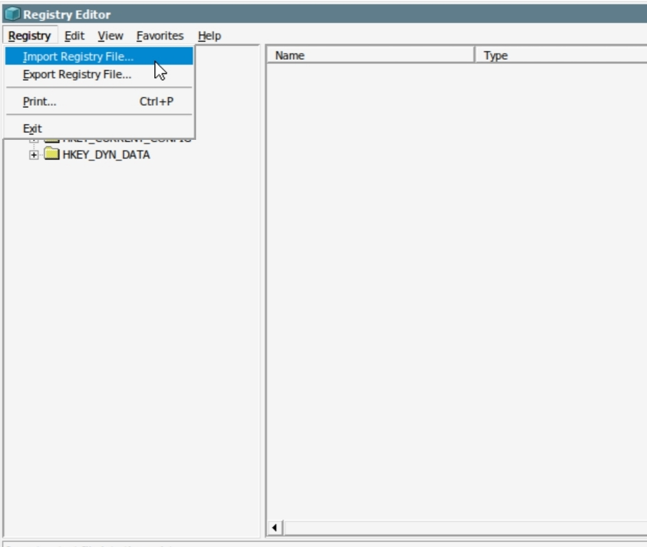
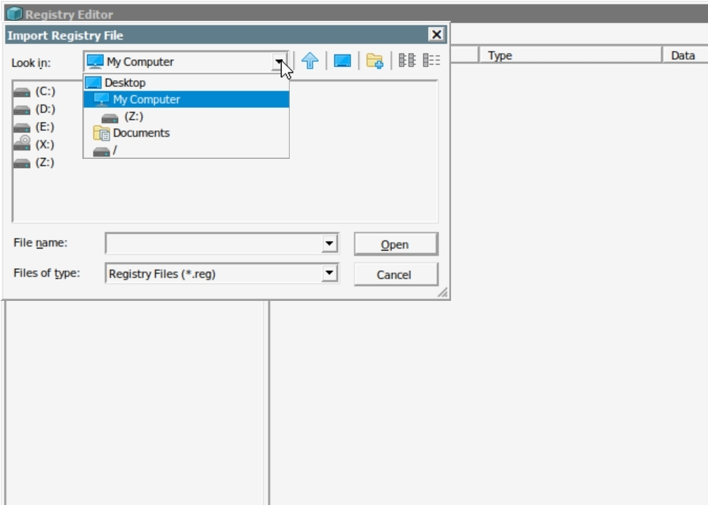

# PaintTool SAI Ver.2 安卓安装教程（新手向 · 图文）

> **做完能得到什么**：Windows 版 PaintTool SAI Ver.2 跑在 Android 平板上，
> 外接数位板或平板自带的笔有**真压感**（线条粗细随力度变化），笔能点菜单和工具栏。
>
> **不需要** root，**不需要**敲命令，全程在平板上点。
>
> **适用设备**：Android 10 以上、arm64，支持 OTG / 蓝牙数位板，或平板自带压感笔（如三星 S Pen）。
>
> **预计耗时**：20～40 分钟，大头是容器初始化和 SAI 首次启动。

> 📺 **视频/图文版**：[安卓终于可以用sai2力 · B站](https://www.bilibili.com/opus/1272346716743401491)
>
> **从 0.3.0 起，压感桥和中文字体已经内置在 APK 里**。
> 新建的容器天生带 `wintab32.dll`、`wt_pmax.txt`、注册表覆盖和中文字体，
> 你只需要：**装 APK → 建容器 → 装 SAI**。
> 用旧版 APK、或想给**已经存在的容器**补桥，见 [附录 A](#附录-a旧版-apk--已有容器手动补桥)。

---

## 目录

1. [开始之前](#一开始之前)
2. [准备文件](#二准备文件)
3. [第 1 步：装补丁版 Winlator](#第-1-步装补丁版-winlator)
4. [第 2 步：建容器](#第-2-步建容器)
5. [第 3 步：装入 SAI](#第-3-步装入-sai)
6. [第 4 步：验收](#第-4-步验收)
7. [日常怎么用](#日常怎么用)
8. [常见问题](#常见问题)
9. [附录 A：旧版 APK / 已有容器手动补桥](#附录-a旧版-apk--已有容器手动补桥)
10. [附录 B：原理与文件位置](#附录-b原理与文件位置)

---

## 一、开始之前

### 1.1 三句实话

- **这一版还不稳定，仅供尝鲜。** 请随时保存（`Ctrl+S`），别把正在画的稿子只留在内存里。
- **SAI 要你自己买、自己下。** 官方地址：<https://www.systemax.jp/>。本项目不提供 SAI 本体、安装包或授权。
- **不买授权也能画**，但**保存文件**需要 SYSTEMAX 的授权证书（`.slc`）。想先试手感的话，画完截图也行。

> 社区里流传的汉化版 / 整合包不是本项目提供的，来源和授权都没法核实，
> 用不用由你自己判断，出问题也别指望这里能修。

### 1.2 已经装了官方 Winlator 怎么办

**必须先卸载官方版**——补丁版包名相同但签名不同，装不上去。

> ⚠️ 卸载会**清空所有容器**，里面的 SAI、画稿、配置一起没。
> 如果里面有东西，先用文件管理器把 `Android/data/com.winlator/files/rootfs/home/` 整个复制出来备份。
> 全新安装没有这个问题。

---

## 二、准备文件

只有两样：

| 文件 | 用途 | 从哪来 |
|---|---|---|
| `Winlator-11.2-SAIPen.apk` | 补丁版 Winlator（内置压感桥 + 中文字体 + 笔点击支持） | Release 附件 |
| PaintTool SAI Ver.2 64bit ZIP | SAI 本体 | **自己购买下载**，见 1.1 |

把 SAI 的 ZIP 放进平板的 **Download** 文件夹，后面在容器里 `D:\` 就能看到。

> 旧版 APK 需要你另外准备 `wintab32.dll`、`wt_pmax.txt`、两个 `.reg` 和字体文件，
> 见 [附录 A](#附录-a旧版-apk--已有容器手动补桥)。

---

## 第 1 步：装补丁版 Winlator

1. 平板上允许「安装未知来源应用」。
2. 点开 `Winlator-11.2-SAIPen.apk` 安装。
3. 首次启动如果弹出 **16 KB 对齐 / 调试签名** 的警告，点「确定 / 继续」，不影响使用。

> **这个 APK 改了什么**：基于原版 Winlator 11.2 逐字节复制，只替换了 `classes.dex`、新增 `classes2.dex`，
> 并替换了新容器的模板。它做四件事：
> ① 把笔压通过 UDP 发给容器里的 `wintab32.dll`；
> ② 把「笔尖接触」翻译成鼠标左键，让笔能点菜单；
> ③ 新建容器时预置 `wintab32.dll`、`wt_pmax.txt`、注册表覆盖和 Noto 中文字体；
> ④ 万一 Wine 在容器首次启动时把 `wintab32.dll` 换回它自带的版本，会在容器界面起来时自动补回。

---

## 第 2 步：建容器

### 2.1 新建容器

1. 打开 Winlator → 右上角 **＋** → 新建容器。
2. 名字随便填（例如 `SAI`）。
3. **屏幕分辨率（Screen Size）选 `custom`**，然后在右边填**设备本身的分辨率**。
   不知道的话：截一张图，在相册里看图片详情里的尺寸。
4. **DPI 适当调大**。参考值：11 英寸 2560×1600 的平板，填 `168` 左右比较舒服。
5. 其他保持默认，保存。

### 2.2 一个必须改的设置

| 位置 | 设置 | 为什么 |
|---|---|---|
| 左上角三横 → ⋮ → **Settings（设置）** | **取消勾选 `Capture pointer on external mouse`**（捕获外部鼠标指针），然后点右下角 ✓ 确认 | 勾着的话容器会抢走系统光标，**数位板事件根本进不来**，笔就完全没反应 |

### 2.3 第一次进容器

点容器右侧 **▶** 启动。首次会自动初始化 Wine，**可能要 1～5 分钟**（新模板要解压字体，比旧版稍久），
屏幕可能黑一会儿，看到 Windows 桌面或文件管理器窗口就成功了。

> 这时容器里已经有了：`C:\windows\system32\wintab32.dll`（我们的，185,607 字节）、
> `C:\wt_pmax.txt`、`C:\windows\Fonts\NotoSansCJK-Regular.ttc`，
> 以及注册表里的 `wintab32=native,builtin` 和字体替换表。**中英文都应该是正常的，不再是方块。**
>
> 如果中文还是方块，见 [Q1](#q1中文全是方块--方框)。

> 退出容器请用返回键或右上角 ✕，**不要直接划掉 App 或强杀**。Wine 要把配置写回磁盘。

---

## 第 3 步：装入 SAI

> 本项目**不提供 SAI 本体、安装包或授权**。请自己合法取得 PaintTool SAI Ver.2
> （SYSTEMAX 官方发布的是 `sai2-...-64bit.zip`，解压即用，没有安装器）。

1. 把 SAI Ver.2 的 64 位 ZIP 传进平板，解压后把**整个目录**放进容器，例如 `C:\SAI Ver.2`。
2. **必须保留 `init/` 子目录和 `sai2.ini`**——只放 `sai2.exe` 会报"构成 SAI 的文件不存在"。
3. 在容器里双击 `sai2.exe`。第一次启动 Wine 要等 10～20 秒才出窗口。

| 现象 | 处理 |
|---|---|
| 报"构成 SAI 的文件不存在" | 目录不完整，缺 `init/` 或 `sai2.ini` |
| 菜单、对话框全是方块 | 中文字体没生效，见 [Q1](#q1中文全是方块--方框) |
| 能画但"保存"不可用 | 还没有授权证书，见下 |

**授权证书（要保存文件才需要）**：在 SAI 里 **Others → System ID** 取本机 System ID，
到 SYSTEMAX 授权页用许可号 + 证书密码 + System ID 下载对应的 `.slc`，
放到 `sai2.exe` 同目录（新版也读 `settings/` 子目录）。以 SYSTEMAX 官方说明为准；
本项目不介入授权，也不提供任何绕过方式。

能打开画布就说明程序本身没问题，压感桥也已经在那了——直接去验收。

---

## 第 4 步：验收

### 4.1 看 DLL 有没有被加载

用文件管理器打开 `C:\wt_status.txt`，内容应该是：

```
open=1
recv=...      ← 你画几笔它会变大
posted=...
pmax=4095
```

- `open=1` → SAI 已经连上压感桥 ✅
- `open=0` 或文件不存在 → 见 [Q2](#q2能画但线条粗细不变没压感)

### 4.2 画一笔

在画布上由轻到重画一条线：

- ✅ **线条粗细随力度变化** = 压感成功
- ✅ **笔能点菜单、工具栏、列表** = 笔点击成功

### 4.3 用笔点 UI

这类笔的硬件特性是：**只发悬停和"接触"，从不发鼠标按键**。
补丁版 APK 会把"笔尖接触"翻译成鼠标左键，所以：

- 笔悬停 → 光标跟着走
- 笔落下 → 等于按下左键（可以拖选区、点菜单）
- 抬起 → 松开

**双击**：两次快速落下-抬起即可（间隔 < 300 ms）。

---

## 日常怎么用

1. 打开 Winlator → 左上角三横 → **Shortcuts** → 点 `sai` 底下的 **▶**。
2. **一条设置改了就废，别碰**：Winlator 里**不要**勾 `Capture pointer on external mouse`。
3. 建议把常用快捷键设到 SAI 工具栏上——笔点比敲键盘方便。
4. 存盘路径建议放 `D:\`（= 平板 Download），方便用手机文件管理器拿出来。

---

## 常见问题

> **先做三件事**：① 容器**正常退出**再重进；② 打开 `C:\wt_status.txt` 看 `open=`；
> ③ 确认 `C:\windows\system32\wintab32.dll` 大小是 **185,607 字节**。
> 八成问题能在这三步里定位。

### Q1：中文全是方块 / 方框

0.3.0 起字体已经内置，正常不该出现。真出现了按顺序查：

1. `C:\windows\Fonts\NotoSansCJK-Regular.ttc` 是否存在（约 19 MB）；
2. 注册表里有没有 `HKCU\Software\Wine\Fonts\Replacements`（值应为 `Noto Sans CJK SC`）；
3. **重启容器**（字体只在启动时扫描）。

两条都不对，说明容器是旧版本模板建的 → 走 [附录 A](#附录-a旧版-apk--已有容器手动补桥)。

### Q2：能画但线条粗细不变（没压感）

按顺序查（90% 是前两条）：
1. `C:\windows\system32\wintab32.dll` 是不是 **185,607 字节**（是 69,632 就是 Wine 自带的那份）；
2. 注册表 `HKCU\Software\Wine\DllOverrides` 下有没有 `"wintab32"="native,builtin"`；
3. `C:\wt_status.txt` 里 `open` 是不是 1；
4. 如果以上都对还没压感，去 SAI 的 **Other → Options → Pen Tablet** 看一眼，
   API 选项是不是被改成了别的（默认就是 WinTab，正常情况下不用动这里）。

### Q2.5：线条有粗细，但**重压不再变粗** / 一用力就到顶

八成是 `C:\wt_pmax.txt` 没放（DLL 退回默认 1023，量程只有 1/4）。
把内容为 `4095` 的 `wt_pmax.txt` 放进 `C:\`，**重启容器**，再画一笔对比。
判断方法：打开 `C:\wt_status.txt`，`pmax=4095` 才对，`pmax=1023` 就是这个原因。

### Q3：笔能画、但点不了菜单

装错 APK 了——必须是本文这套**补丁版**。官方原版 Winlator 没有这个合成逻辑。

### Q3.5：换了个容器后，SAI 弹「WinTab 驱动返回了错误」/ 完全没压感

用 0.3.0 及以后的 APK 新建的容器不会再有这个问题。
如果是旧版 APK 建的容器，或者容器是在升级 APK **之前**建的，按
[附录 A](#附录-a旧版-apk--已有容器手动补桥) 手动补一遍即可（新 APK 会在容器界面起来时自动补 DLL，
注册表和字体仍需手动，或者直接把 SAI 装到新容器里）。

### Q4：光标消失 / 笔完全没反应

Winlator 容器设置里 `Capture pointer on external mouse` 又勾上了，取消即可。

### Q5：每次打开画第一笔，弹 `FileError(161) / A file I/O error has occurred`

**已知问题，非致命**：SAI 把"撤销历史"写盘时，Wine 返回了 `ERROR_BAD_PATHNAME`。
- 点掉对话框即可，作画、撤销、保存都正常；
- 已排除权限、磁盘、内存、SELinux（排查记录见 [04-patching-winlator.md](./04-patching-winlator.md) 第八节）；
- 要彻底修只能改 Wine，性价比低。

### Q6：装完 SAI 打不开 / 一进容器就闪退

1. 确认装的是补丁版 APK（早期版本有过 dex 校验错误，已修）；
2. 容器分辨率换成 `1280x720` 再试；
3. 换一个全新容器重装（最省时间的排查方式）。

### Q7：中文界面怎么切回英文 / 其它语言

打开 `C:\SAI Ver.2\sai2.ini`（用记事本 / 文件管理器打开），改第一段：

```ini
[Locale]
lang = zh      ; 中文
lang = en      ; 英文
```

改完重启 SAI。

### Q8：笔的落笔位置和光标对不上

别在 Winlator 里开"缩放 / 拉伸"。容器分辨率和板子比例不同会有轻微纵向拉伸；
实在在意就调板子的映射区域（高级操作），或者把容器分辨率设成和屏幕一致。

### Q9：抬笔后还在画 / 左键像"粘住"了

0.1.2 起已经修：抬笔若只发悬停（压力归零）也算抬起，并且按下后 750 ms 没有新事件会自动松手。
如果你还在旧包上，升级 APK 即可（同签名直接覆盖，容器数据保留）。

### Q9.5：画完一笔、等一下再画下一笔，两笔被一条直线接在一起

**症状**：两笔之间多出一条从上一笔终点连到下一笔起点的直线（手指画时最明显）。

**原因**：SAI 的 WinTab 笔画不是收到一个零压包就收笔的。真实数位板抬笔后笔还留在感应区里
悬停，驱动会继续送**位置在变**的零压样本，SAI 靠这些样本确认"笔真的抬起来了"。手指没有
悬停事件，桥在抬笔时只发了一个和终点同位置的零压包，SAI 就认为这一笔还没结束，下一笔的
第一包从上一笔终点接了过去。

**修复**（`PenBridge.emit()`）：**只对手指**，每次抬笔后在同一个抬笔队列里再补两个零压样本，
位置各挪 1~2 px。它们不会落墨，只用来让 SAI 收笔。真机实测：同一位置补零压包不够，位置挪 1 px 就够。

笔（内置笔/蓝牙笔）不要补：它们在抬笔后本来就会继续发 `HOVER_MOVE`，额外补的零压样本会扰乱
笔的起笔和压力（0.3.2 上表现为轻画几乎不出墨、要用力压才出线），0.3.3 起只对手指补。

如果你在旧包上遇到这个现象，升级 APK 即可。

### Q10：画超长线时 CPU 占满、整个容器卡死

**症状**：一笔画到一半，SAI 七个线程各 100% 空转，系统开始大量用 swap，触控完全没反应，
画完（甚至停笔）之后也不恢复，只能强杀容器。

**原因不在压感桥，而在"插件式汉化"注入的那个 DLL。**
以 `PivInk` 汉化版为例，它的 `PivInk.dll` 导入了 `SuspendThread` / `ResumeThread` /
`OpenThread` / `GetThreadContext` / `SetThreadContext` / `Thread32First/Next`——会枚举并挂起、
改写其他线程的上下文（用来安全地改写 SAI 的代码以显示中文）。在 box64 的动态翻译下，
挂起一个正在跑 JIT 代码的线程会让多个线程互相等待并自旋，表现就是 SAI 的 22 个线程里
有 7 个 100% 卡住、swap 暴涨、整机无响应，而且停笔后不恢复。线越长，线程活跃越久，越容易踩到。

已验证排除的方向：调 box64（`BIGBLOCK=0` / `WAIT=0`，通过 rc 和容器 env 都试过，容器没采纳）、
把输入限速到 166 Hz（0.3.2 已内置，仍然卡）。所以这不是负载或参数问题。

**解决**：用 SYSTEMAX 官方的 SAI Ver.2（64 位 ZIP）。官方版实测画同样的长线完全正常，
只是没授权时"保存"不可用（作画、撤销都正常）。本项目只支持官方版。

> 排查时可对照：官方版正常 + 破解版卡死 → 就是保护壳的问题，换官方版即可，不用改 APK。

---

## 附录 A：旧版 APK / 已有容器手动补桥

桥的四样东西都装在**容器内部**，不跟 App 走。旧版 APK 建的容器、或升级 APK 之前就存在的容器，
需要手动补一次。**用 0.3.0 及以后 APK 新建的容器不需要做这一步。**

需要准备（旧版 Release 的 `dist/` 或网盘包里都有）：

| 文件 | 放哪里 |
|---|---|
| `wintab32.dll`（185,607 字节） | `C:\windows\system32\` |
| `wt_pmax.txt`（内容 `4095`） | `C:\` |
| `1-压感覆盖.reg` | 导入 → `DllOverrides` + `WT_DEBUG` |
| `2-中文字体.reg` + `NotoSansCJK-Regular.ttc` | 字体放 `C:\windows\Fonts\`，再导入替换表 |

### A.1 手动补 DLL

1. 文件管理器左侧点 `D:\`（= 平板 Download）→ 进放文件的文件夹 → 选中 `wintab32.dll` → **复制**。
2. 左侧点 `C:\` → 双击 `windows` → 双击 `system32` → **粘贴** → 提示替换选 **Yes**。

### A.2 导入注册表

**① 打开注册表编辑器**：左下角 **Start** → **System Tools** → **Registry Editor**。


**② 打开导入对话框**：菜单栏 **Registry → Import Registry File…**



**③ 选择文件**：把 **Look in** 切换成 **My Computer**，
然后进 `(D:)` → 你的文件夹 → 选 `.reg` → **Open / 确定**。



**④ 正常退出容器再重进**：注册表改动只在正常退出时写盘，切容器/强杀会丢。

> 旧版 APK 新建容器后，Wine 会把 `system32\wintab32.dll` 覆盖回自带的那份（69,632 字节）。
> 新版 APK 会自动补回；旧版需要你按 A.1 手动再放一次，**每次新建容器都要放**。

---

## 附录 B：原理与文件位置

### 整条链路

```
数位板 → Android MotionEvent（压力）
      → 补丁版 Winlator 里的 PenBridge（工作线程，UDP 127.0.0.1:47800）
      → 容器内 wintab32.dll（Box64 下运行）
      → WT_PACKET → SAI 画布
```

### 容器里都有什么

| 路径 | 内容 | 谁放的 |
|---|---|---|
| `C:\windows\system32\wintab32.dll` | 压感桥（185,607 字节） | 模板 + App 自愈 |
| `C:\wt_pmax.txt` | 压力上限 4095 | 模板 |
| `C:\windows\Fonts\NotoSansCJK-Regular.ttc` | 中文字体 | 模板 |
| `C:\wt_status.txt` | 运行状态（`open/recv/posted/fetched`） | DLL 运行时 |
| `C:\wtlog.txt` | 详细日志（排错用） | DLL 运行时 |
| 注册表 `HKCU\Software\Wine\DllOverrides` | `wintab32=native,builtin` | 模板 |
| 注册表 `HKCU\Software\Wine\Fonts\Replacements` | 6 条字体替换 | 模板 |

容器在平板里的真实位置：

```
/data/data/com.winlator/files/rootfs/home/xuser-N/
```

`home/xuser` 是指向**最新容器**的符号链接，所以路径里写 `xuser` 永远是对的。

### 想备份整套环境

把 `home/xuser-N/` 整个目录复制走即可（含 SAI、DLL、注册表、字体）。
换机 / 重装后放回同一位置，再建容器指向它就行。

---

*文档版本：2026-11-19（对应 APK 0.3.0）。机器相关的一次性排查记录见
[04-patching-winlator.md](./04-patching-winlator.md)、[06-device-test-log.md](./06-device-test-log.md)。*
